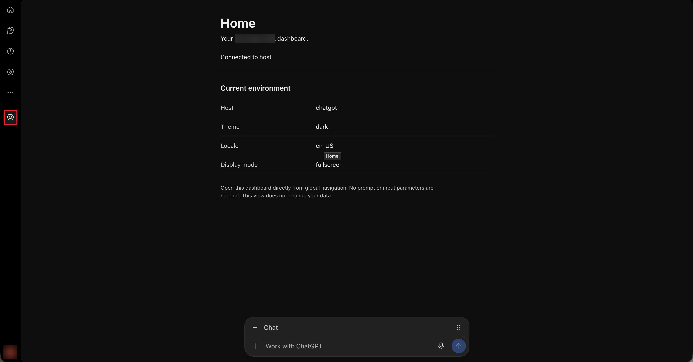
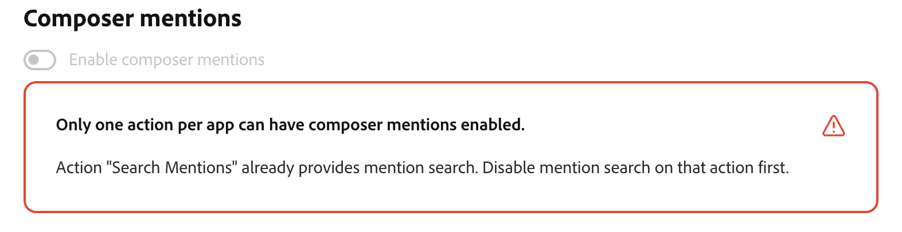

# Configurar extensões do ChatGPT {#chatgpt-extensions}

>[!IMPORTANT]
>
>[!DNL Adobe LLM Apps] está atualmente na Beta.
>
>Os recursos, fluxos de trabalho e interface mostrados aqui não representam necessariamente o estado final do produto. Para participar da Beta, envie um email para llm-apps-beta@adobe.com.

**Estas são extensões somente de ChatGPT.** Eles não configuram recursos em [!DNL Claude] ou outras plataformas LLM. Seu aplicativo ainda pode funcionar nessas plataformas por meio de ações e widgets padrão.

Use as **[!UICONTROL Extensões ChatGPT]** para permitir que as pessoas abram seu aplicativo diretamente, mantenham-no ao lado de uma conversa, exibam arquivos com suporte ou localizem itens ao redigir uma mensagem.

**Neste guia:** Saiba como configurar esses recursos opcionais e o que as pessoas podem fazer com eles. Um catálogo de produtos é o exemplo; ative apenas os recursos de que seu aplicativo precisa.

Os contornos vermelhos nas capturas de tela realçam os controles usados nas etapas. São anotações de documentação, não indicadores de erro de interface do usuário.

## Antes de começar {#before-you-begin}

Você precisa:

- Um aplicativo LLM existente, permissão para editar suas ações e uma ação de trabalho para a tarefa.
- Um widget publicado para abertura direta ou exibição de arquivo. As ações somente texto podem fornecer pesquisa de menção, mas não pontos de entrada.
- `@adobe/llm-apps-runtime` 1.3.0 e, para os recursos do widget, `@adobe/llmapps-sdk` 0.2.1 ou versões posteriores com suporte. Peça ao mantenedor do aplicativo para confirmar ambas as versões e atualizar os scripts de widget fornecidos, se necessário.
- Um aplicativo conectado e um cliente compatível com a extensão selecionada.

>[!IMPORTANT]
>
>A disponibilidade varia conforme o cliente. Os pontos de entrada do arquivo são **somente desktop**; as menções do compositor exigem **desktop ou o navegador de Trabalho**. A coluna de suporte da Web do OpenAI exclui o [!DNL ChatGPT] clássico. Verifique o [suporte da plataforma](https://github.com/openai/mcp-extensions/blob/main/docs/spec.md#platform-support) antes de testar.

>[!IMPORTANT]
>
>As configurações **não** criam um visualizador de arquivos ou implementam a pesquisa. Peça ao mantenedor para preparar primeiro a [ação](/help/guides/customize-handler.md) e o [widget](/help/guides/widgets.md) necessários.

## Abrir extensões ChatGPT {#open-extensions}

1. Abra o aplicativo e selecione **[!UICONTROL Ações]**.
1. Abra a ação que deseja configurar.
1. Selecione a guia **[!UICONTROL ChatGPT Extensions]**.

A guia também está disponível durante a criação da ação. Este guia usa uma ação existente e revisada.

Selecione **[!UICONTROL Salvar alterações]** após a edição. Para publicar a configuração, siga [Implantar seu aplicativo](/help/guides/deploy-your-app.md) e [atualizar a conexão ChatGPT](/help/guides/test-in-chatgpt.md#refresh-after-app-changes).

## Escolha onde as pessoas abrem seu aplicativo {#configure-entrypoints}

Um **ponto de entrada** é um local onde as pessoas abrem seu aplicativo sem pedir ao modelo para chamá-lo.

>[!NOTE]
>
>Você pode selecionar vários pontos de entrada para o mesmo widget. Os pontos de entrada fornecem maneiras adicionais de abri-lo; eles não substituem a invocação normal do chat. Quando a ação está disponível para o modelo, as pessoas ainda podem solicitá-la no chat e receber o widget.

1. Em **[!UICONTROL Entrypoints]**, insira opcionalmente uma URL de imagem HTTPS pública na **[!UICONTROL URL do ícone]**. O ícone é compartilhado pelos pontos de entrada desta ação; use uma imagem que você tenha permissão para publicar.
1. Em **[!UICONTROL Onde os usuários podem abrir este aplicativo]**, marque qualquer combinação das caixas de seleção a seguir para o mesmo widget. Deixe tudo desmarcado se a ação não precisar de abertura direta.

   | Tipo | Resultado |
   |---|---|
   | **[!UICONTROL Global]** | Abrir tela cheia do catálogo na navegação |
   | **[!UICONTROL Thread]** | Abrir o catálogo como uma guia ao lado de uma conversa |
   | **[!UICONTROL Arquivo]** | Abrir arquivos correspondentes no visualizador personalizado |

1. Para Global ou Thread, confirme se a ação funciona sem as entradas necessárias.
1. Para Arquivo, conclua a configuração abaixo.

Por exemplo, selecione Global e Thread para abrir o mesmo widget de catálogo da navegação ou ao lado de uma conversa. Você também pode selecionar Arquivo se o widget suportar visualização de arquivos. Quando Arquivo for combinado com Global ou Thread, deixe **[!UICONTROL Obrigatório]** desmarcado para a entrada `file`: as inicializações de arquivo ainda fornecem o objeto do arquivo, mas as inicializações Global e Thread sem entradas. O manipulador e o widget devem aceitar ambos os casos. Uma ação somente Arquivo pode exigir `file`.

**Resultado esperado:** Abra o catálogo a partir da navegação para Global ou como uma guia de conversa para Thread.

### Abrir a partir de uma navegação ou conversa {#test-global-thread}

As capturas de tela fornecidas pelo usuário a seguir ilustram o painel **Página inicial** em vez do exemplo de catálogo. A navegação e a disposição do menu podem variar de acordo com o cliente.

Para **Global**, abra o menu de navegação e selecione o ponto de entrada do seu aplicativo. Neste exemplo, o ponto de entrada é **Início**.

Confirme se o painel abre em tela cheia, com o painel de navegação ainda disponível.

Para **Thread**, abra o menu de conversa, selecione **[!UICONTROL Plug-ins]** e escolha o ponto de entrada. Confirme se o widget abre ao lado da conversa sem precisar de um novo prompt.

### Abra um arquivo compatível no seu aplicativo {#file-entrypoint}

Para um visualizador de catálogo CSV preparado:

1. Marque a caixa de seleção **[!UICONTROL Arquivo]**, selecione **[!UICONTROL Adicionar extensão]** e digite `.csv`. Adicione cada extensão compatível em seu próprio campo.
1. Em **[!UICONTROL Detalhes da ação]** > **[!UICONTROL Parâmetros de entrada]**, confirme um parâmetro **Objeto** chamado `file` que aceite `name` e `resourceUri`. Selecionar Arquivo adiciona uma entrada de Objeto opcional se nenhum parâmetro `file` existir; verifique qualquer definição existente. Nenhuma outra entrada pode ser necessária. Mantenha `file` opcional se Global ou Thread também estiver selecionado.
1. Em um cliente de desktop com suporte, abra um arquivo `.csv` não confidencial com seu aplicativo.

**Resultado esperado:** o widget exibe o arquivo. Salvar edições também requer suporte à edição implementada e um arquivo gravável.

>[!IMPORTANT]
>
>Os pontos de entrada do arquivo são diferentes dos parâmetros do arquivo carregado. Eles recebem uma referência de recurso de arquivo aberto, não um URL de download de upload ou ID de arquivo.

## Escolha como o aplicativo é exibido {#display-settings}

Em **[!UICONTROL Modo de exibição]**:

1. Definir **[!UICONTROL Exibição quando iniciado pelo modelo]** como `inline`, `fullscreen` ou **[!UICONTROL Nenhuma preferência]**.
1. Selecione os **[!UICONTROL Modos de exibição de recursos com suporte]** do widget: Em linha, Tela cheia ou ambos. Deixe ambos desmarcados para usar os padrões do host.
1. Escolha **[!UICONTROL Exibição inicial do recurso]**. Se você selecionou modos compatíveis, o modo inicial deve ser incluído.

Estas são as preferências; [!DNL ChatGPT] escolhe a apresentação final. A tela cheia não cria uma guia do painel lateral: use um ponto de entrada Thread para isso.

Verifique se o widget permanece utilizável em cada modo anunciado.

## Permitir que as pessoas encontrem recursos no compositor {#composer-mentions}

As menções do compositor permitem que as pessoas pesquisem e selecionem itens de catálogo ao escrever uma mensagem. Use uma ação que já retorne resultados de pesquisa selecionáveis.

1. Abra a ação de pesquisa e selecione **[!UICONTROL Detalhes da ação]**.
1. Confirme uma entrada **String** chamada `query` que aceite texto vazio, sem outras entradas necessárias.
1. Nas **[!UICONTROL configurações de LLM]**, habilite a **[!UICONTROL dica somente leitura]** e o **[!UICONTROL Mostrar como widget na superfície do aplicativo]**. A ação de pesquisa deve ser realmente somente leitura.
1. Em **[!UICONTROL ChatGPT Extensions]**, ative **[!UICONTROL Habilitar menções ao compositor]**.
1. Somente um provedor é permitido por aplicativo. Se estiver substituindo um, desative as menções no provedor antigo e salve-o antes de ativar o novo provedor.

**Resultado esperado:** pesquise por um produto conhecido na pesquisa de menção do compositor do aplicativo, selecione-o e confirme se o recurso desejado é referenciado na mensagem.

A configuração de visibilidade disponibiliza a ação de pesquisa para o aplicativo. O provedor não precisa de seu próprio widget visual.

O exemplo a seguir usa **Menções de pesquisa**, uma ação somente texto que pesquisa documentos sintéticos em vez do catálogo. Sua entrada `query` é uma **Cadeia de caracteres** com **Obrigatório** desmarcado.

Na guia **[!UICONTROL ChatGPT Extensions]** da mesma ação, **[!UICONTROL Habilitar menções ao compositor]** está ativado.

Se outra ação já fornecer mencionar pesquisa, o botão de alternância não estará disponível e um aviso identificará essa ação. Desative as menções no provedor existente e salve antes de ativar uma substituição.

## Recursos adicionais do widget ChatGPT {#additional-widget-features}

O SDK também oferece suporte a deep links específicos para ChatGPT, contexto de seleção estendida, rascunhos editáveis e direcionamento de conversação. Eles precisam de implementação de widgets, não de outro switch nesta guia.

| Se o seu widget fornecer | Experimente |
|---|---|
| Um link para um item | Abra o link e confirme se o produto pretendido é exibido |
| Contexto de seleção | Selecione um produto não sensível e faça uma pergunta sobre ele |
| Um rascunho ou controle de nova conversa | Confirme se a mensagem é aberta onde esperado e um rascunho não é enviado automaticamente |

Mensagens básicas de widget e outras APIs padrão do SDK não são somente ChatGPT. Pergunte ao mantenedor quais extensões o widget implementa; consulte a [documentação do SDK](https://www.npmjs.com/package/@adobe/llmapps-sdk).

## Alterar ou remover uma extensão {#change-or-remove}

Na mesma guia, desmarque a caixa de seleção do ponto de entrada ou desative **[!UICONTROL Habilitar menções ao compositor]**. Limpe Arquivo se nenhuma extensão permanecer. Para remover o ícone compartilhado, selecione **[!UICONTROL Ícone Limpar]**. Para restaurar os padrões de exibição, selecione **[!UICONTROL Nenhuma preferência]**, limpe os modos com suporte e selecione **[!UICONTROL Padrão de host]**.

A remoção de um ponto de entrada não exclui os arquivos de ação ou usuário. Consulte [regras e definições de campo](/help/reference/reference-docs.md#chatgpt-extension-fields).

## Resolução de problemas {#troubleshooting}

| O que você vê | O que fazer |
|---|---|
| Recurso ou controles ausentes | Verifique o [suporte ao cliente](#before-you-begin). Para pontos de entrada, confirme se um widget está configurado. Estas extensões não se aplicam ao Claude ou a outros hosts |
| Salvar relatórios e uma entrada obrigatória incompatível | O suprimento global/de thread não tem entradas, o suprimento de arquivo `file` e o suprimento de menção `query`. Peça ao mantenedor para resolver a incompatibilidade; não remova uma entrada que a ação precise |
| Falha na configuração ou exibição do arquivo | Adicione uma extensão com suporte, confirme a entrada do Objeto `file` e use um cliente de área de trabalho compatível. O widget deve implementar esse formato de arquivo |
| Falha ao salvar arquivo | Confirme a edição do suporte e a permissão de gravação. Reconciliar conflitos em vez de substituir o conteúdo mais recente; reduzir o conteúdo superdimensionado |
| O URL do ícone não pode ser salvo | Insira um URL de imagem ou URI de dados válido ou limpe o ícone opcional. Preferir um URL de imagem HTTPS público |
| A configuração de exibição foi rejeitada ou ignorada | Inclua o modo inicial entre os modos compatíveis. O ChatGPT controla a apresentação final |
| As menções não podem ser ativadas | Verifique o comportamento somente leitura, a visibilidade do aplicativo e a entrada `query`. Salve a remoção do provedor antigo antes de habilitar sua substituição |
| A pesquisa não retorna itens ou um erro | Tente um item conhecido. Resultados vazios podem ser válidos; relatar itens conhecidos ausentes ou erros para o mantenedor da pesquisa |
| As ações não podem ser carregadas | Use **[!UICONTROL Repetir o carregamento das ações do aplicativo]** ou **[!UICONTROL Atualizar ações do aplicativo]** quando oferecido |
| Falha na criação de rascunho | Verifique o suporte ao cliente. Não enviar automaticamente uma mensagem que foi concebida como rascunho |
| Alterações salvas ausentes | Implante no ambiente testado, atualize a conexão e confirme se as alterações do widget foram publicadas |
| Blocos de ponto de entrada de Configurações sem suporte salvos | Marque as caixas de seleção Global, Thread ou Arquivo compatíveis ou deixe todas desmarcadas |

Para obter suporte, registre o aplicativo, o ambiente, o cliente, a etapa com falha e o erro visível. Não inclua tokens, URLs privados ou dados confidenciais.

## O que vem a seguir {#whats-next}

- [Implante seu aplicativo](/help/guides/deploy-your-app.md)
- [Testar seu aplicativo LLM como um plug-in ChatGPT](/help/guides/test-in-chatgpt.md)
- [Personalizar um widget gerado](/help/guides/widgets.md)
