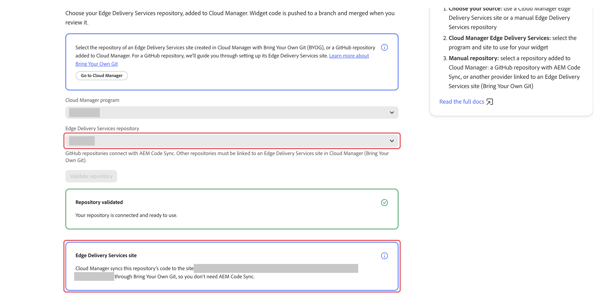
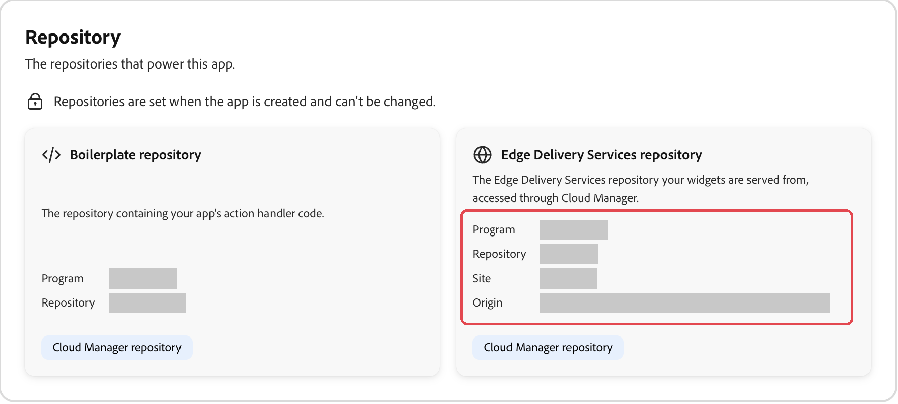

# Configuração da infraestrutura {#create-first-app}

>[!IMPORTANT]
>
>Aplicativos LLM está disponível para todos os clientes do AEM Sites Cloud Service para desenvolver e gerenciar seus próprios aplicativos. Depois que a medição for iniciada, cada chamada de aplicativo será contabilizada nas Solicitações de conteúdo do AEM Sites do cliente. A Adobe anunciará a taxa de medição e a data de início antes de a medição entrar em vigor.

A infraestrutura é a base técnica do seu aplicativo: os repositórios que armazenam seu código e os serviços que executam seus manipuladores de ação e fornecem seus widgets aos usuários.

Conforme explicado na [visão geral](/help/overview/overview.md#key-concepts), um **manipulador de ações** executa uma tarefa, como localizar produtos, enquanto um **widget** apresenta o resultado como uma experiência interativa na conversa.

[!DNL LLM Apps] armazena o código-fonte do manipulador e do widget em dois repositórios separados:

- **Repositório de ações** — contém os manipuladores do lado do servidor e seus testes.
- **Repositório de widgets** — contém o código e os estilos dos widgets interativos.

Por exemplo, um manipulador de pesquisa de produto recupera produtos correspondentes e seu widget os exibe como cartões de produto. Os repositórios armazenam esse código; o Adobe I/O Runtime executa os manipuladores implantados e o Edge Delivery Services fornece os widgets.

O assistente de configuração prepara esses repositórios e conecta os serviços de que seu aplicativo precisa. Escolha uma das duas opções:

- **[!DNL LLM Apps]infraestrutura gerenciada** é a maneira mais rápida de começar. O Adobe cria e hospeda os repositórios para seus manipuladores de ação e widgets, de modo que você não precisa configurar repositórios sozinho.
- **Seus próprios repositórios** mantenha o código do aplicativo nos repositórios que possui, adicionados a [!DNL Cloud Manager]. Eles podem ser hospedados em [!DNL GitHub], [!DNL GitHub Enterprise], [!DNL GitLab], [!DNL Bitbucket] ou [!DNL Azure DevOps]. A plataforma inicializa repositórios vazios com os arquivos de projeto necessários, de modo que não é necessário preparar o código de ação ou widget antecipadamente.

**Neste guia:** saiba como escolher uma opção de infraestrutura e criar seu aplicativo com o assistente de configuração. Após a instalação, continue em [Criar ações](/help/guides/creating-actions.md).

A criação do aplicativo **não** inicia a geração da ação. Inicie a geração de ação separadamente da página do aplicativo.

## Abrir o assistente criar aplicativo

Abra os [Aplicativos Adobe LLM](https://experience.adobe.com/llm-apps). Na página de boas-vindas, selecione **[!UICONTROL Introdução]**. Se você já tiver um aplicativo aberto, use o seletor de aplicativos e selecione **[!UICONTROL Criar novo aplicativo]**.

O assistente **[!UICONTROL Criar Aplicativo LLM]** começa com **[!UICONTROL Introdução]**. Escolha como configurar o ambiente técnico.

| Opção de infraestrutura | Selecionar no assistente | O que significa |
|---|---|---|
| **[!DNL LLM Apps]infraestrutura gerenciada** | **[!UICONTROL Deixe-nos lidar com isso]** | A Adobe cria e gerencia os repositórios e serviços conectados para seu aplicativo. O acesso ao código está disponível mediante solicitação. |
| **Seus próprios repositórios** | **[!UICONTROL Usar minha configuração do Cloud Manager]** | Você seleciona dois repositórios adicionados a [!DNL Cloud Manager]: um para manipuladores de ação e outro para widgets. A plataforma os inicializa se estiverem vazios. |

Ambas as opções oferecem suporte à geração de ação automática posteriormente. Nenhuma opção requer que você grave ações manualmente.

## Usar infraestrutura gerenciada [!DNL LLM Apps] {#adobe-managed-infrastructure}

Use essa opção para permitir que a Adobe configure e gerencie os repositórios e serviços conectados para seu aplicativo. Não é necessário criar repositórios ou instalar [!DNL GitHub] aplicativos você mesmo.

1. Selecione **[!UICONTROL Let us handle it]**.
2. Selecione **[!UICONTROL Próxima etapa]**.
3. Conclua os [detalhes do aplicativo](#app-details).
4. Selecione **[!UICONTROL Criar aplicativo]**.

A página do aplicativo mostra **[!UICONTROL Configurando seu aplicativo]** enquanto o Adobe prepara os repositórios e conecta o site do widget. A interface do usuário indica que a configuração geralmente leva de 1 a 2 minutos; as ações, os testes e a implantação permanecem indisponíveis até que a configuração esteja pronta.

Se a instalação falhar, leia o erro e selecione **[!UICONTROL Repetir]**. Se a página não puder verificar o progresso, a instalação continuará em segundo plano; selecione **[!UICONTROL Verificar novamente]** para se reconectar.

Quando a instalação for concluída, continue com [Criar ações](/help/guides/creating-actions.md).

## Usar seus próprios repositórios {#your-own-repositories}

Selecione **[!UICONTROL Usar minha configuração do Cloud Manager]** e **[!UICONTROL Próxima etapa]**. Esse caminho tem quatro etapas do assistente:

**Introdução → Configuração da infraestrutura de ação → Configuração da infraestrutura do widget → Detalhes do aplicativo.**

O [!DNL LLM Apps] alcança seus repositórios por meio do [!DNL Cloud Manager], usando sua conta da Adobe. Você não instala um aplicativo [!DNL GitHub].

### Antes de começar {#own-repositories-prerequisites}

- Acesso ao programa [!DNL Cloud Manager] ao qual o aplicativo pertencerá.
- Dois repositórios, um para manipuladores de ação e outro para widgets. Repositórios vazios são adequados, incluindo um repositório que contém somente o arquivo README cujo host Git foi criado.
- Ambos os repositórios [adicionados ao Cloud Manager](https://experienceleague.adobe.com/en/docs/experience-manager-cloud-manager/content/managing-code/external-repositories) como repositórios privados, com propriedade validada e status **Pronto**. [!DNL Cloud Manager] deve ser capaz de gravar neles; um token de acesso somente leitura não é suficiente.

Somente os repositórios que você hospeda são listados. Repositórios hospedados pela Adobe em [!DNL Cloud Manager] não são suportados.

#### O repositório de widgets é um site do Edge Delivery Services {#widget-repository-is-an-eds-site}

Os widgets são fornecidos por um site do [!DNL Edge Delivery Services] (EDS), e seu repositório de widgets contém o código desse site. Certifique-se de que o repositório do widget pertence a um site EDS ou pertencerá a. Há duas maneiras de configurar uma:

- **Qualquer provedor Git, com Traga seu próprio Git.** Crie o site de EDS em [!DNL Cloud Manager] e vincule-o ao seu repositório com **Traga seu próprio Git**. [!DNL Cloud Manager] então sincroniza o código do repositório no site. Faça isso antes de iniciar o assistente. Consulte [Traga seu próprio Git](https://www.aem.live/developer/byo-git).
- **Um repositório [!DNL GitHub], com a Sincronização de Código AEM.** Configure você mesmo o site de EDS, como no [tutorial do Edge Delivery Services](https://www.aem.live/developer/tutorial). O assistente o orienta durante a instalação da Sincronização de código do AEM e a verificação do acesso após a validação do repositório.

A etapa do widget detecta qual caso se aplica. Consulte [Configurar a infraestrutura do widget](#set-up-the-widget-infrastructure).

>[!TIP]
>
>Mesmo que sua empresa já tenha um site EDS, crie um site EDS separado para seus widgets do [!DNL LLM Apps].

>[!NOTE]
>
>Para um repositório vazio, a validação grava os arquivos iniciais do projeto. Escolha os repositórios destinados a este aplicativo antes de selecionar **[!UICONTROL Validar repositório]**.

### Configurar a infraestrutura de ação

O repositório de ações contém os manipuladores do lado do servidor e os testes que são executados quando uma plataforma LLM chama uma ação.

1. Em **[!UICONTROL programa Cloud Manager]**, selecione o programa que contém seu repositório de ações.
2. Em **[!UICONTROL repositório do Cloud Manager]**, selecione o repositório de ações. Se estiver ausente, adicione-o em [!DNL Cloud Manager] com **[!UICONTROL Vá para Cloud Manager]** e atualize a lista.
3. Selecione **[!UICONTROL Validar repositório]**. A validação inicializa um repositório vazio com o modelo de aplicativos Adobe LLM. Um repositório existente deve conter um projeto de ações compatíveis.
4. Quando **[!UICONTROL Repositório validado]** aparecer, selecione **[!UICONTROL Próxima etapa]**.

A plataforma envia o código de ação gerado para uma ramificação desse repositório. Selecionar **[!UICONTROL Marcar como revisado]** mescla a ramificação. Consulte [Criar ações](/help/guides/creating-actions.md).

### Configurar a infraestrutura do widget {#set-up-the-widget-infrastructure}

Os widgets são respostas visuais opcionais anexadas a ações, como cartões de produto ou formulários de reserva. O Edge Delivery Services (EDS) os envia de um site que usa o repositório de widgets.

1. Em **[!UICONTROL Origem do widget]**, selecione **[!UICONTROL Selecionar repositório de widget manualmente]**.

   

2. Em **[!UICONTROL programa Cloud Manager]**, selecione o programa que contém o repositório de widgets. Ele pode diferir do programa do repositório de ações.
3. Em **[!UICONTROL repositório do Edge Delivery Services]**, selecione o repositório de widgets. Não selecione o repositório de ações.
4. Selecione **[!UICONTROL Validar repositório]**. A validação inicializa um repositório vazio com o modelo do AEM. Um repositório existente deve ser um projeto de EDS compatível.

O que acontece a seguir depende de onde o repositório de widgets está hospedado.

#### Repositório de widgets em outro provedor (Traga seu próprio Git) {#widget-repository-byog}

Para um repositório em [!DNL GitLab], [!DNL Bitbucket], [!DNL Azure DevOps] ou [!DNL GitHub Enterprise], a validação encontra o site de EDS que [!DNL Cloud Manager] vincula ao repositório. O assistente mostra o site em **[!UICONTROL site do Edge Delivery Services]**.

O [!DNL Cloud Manager] sincroniza o código do repositório para esse site, de modo que você não precisa da Sincronização de Código do AEM. Selecione **[!UICONTROL Próxima etapa]**.

Se a validação relatar que nenhum site está vinculado, vincule o repositório a um site EDS em [!DNL Cloud Manager] com **Traga seu próprio Git** e, em seguida, valide novamente. Consulte [Traga seu próprio Git](https://www.aem.live/developer/byo-git).

#### Repositório de widgets no GitHub {#widget-repository-github}

Um repositório do [!DNL GitHub] usa a Sincronização de código do AEM para publicar seu código. Após a validação, o assistente mostra **[!UICONTROL Instalar Sincronização de Código do AEM]**. Use a mesma conta do Adobe para [!DNL LLM Apps], acesso ao site do AEM e acesso de gravação do DA.

##### Configurar o acesso ao site do AEM {#aem-site-access}

**Nova instalação:** Selecione **[!UICONTROL Instalar Sincronização de Código AEM]** e conceda a ele acesso ao repositório de widgets. Conclua o assistente de configuração na página de confirmação da instalação para adicionar a si mesmo como administrador do site.

**Site EDS existente:** mantenha sua instalação da Sincronização de Código do AEM e confirme se ela abrange o repositório de widgets selecionado. Peça a um administrador de site existente para abrir o Administrador de Usuários do AEM em `https://tools.aem.live/tools/user-admin/index.html/?org=<org>&site=<site>` e adicionar sua conta do Adobe com a função `admin`. Não é necessário reinstalar a Sincronização de código.

Substitua `<org>` e `<site>` por sua organização da AEM e nomes de site. O administrador do site pode confirmar esses valores.

##### Conceder acesso de gravação do DA {#da-write-access}

Para sites novos e existentes, peça a um administrador de organização de DAs para:

1. Abra a configuração do DA em `https://da.live/config#/<org>/`, substituindo `<org>` pela organização do DA que armazena o conteúdo do site.
2. Abra a planilha **permissões**. Se não existir, selecione **[!UICONTROL Adicionar planilha]**, nomeie-a como `permissions` e adicione os cabeçalhos de coluna **caminho**, **grupos** e **ações**. Você também pode adicionar uma coluna **comentários** para descrever cada regra.
3. Adicione uma linha que conceda à sua conta da Adobe acesso de gravação a todo o conteúdo do site: use o caminho de conteúdo do site em **caminho**, o email da sua conta do Adobe em **grupos** e `write` em **ações**. Salve a configuração.

   

   A captura de tela usa contas fictícias. Substitua `widget-author@example.com` pelo email da sua conta da Adobe e use o caminho do conteúdo do seu site em vez do exemplo de `/ + **` em toda a organização. A linha `CONFIG` é para administradores de configuração; você não precisa alterá-la para conceder acesso ao conteúdo.

As funções de site do AEM não concedem acesso de gravação do DA. Você não precisa de acesso de gravação em toda a organização.

Para obter detalhes sobre como configurar permissões do DA, consulte [Permissões e segurança](https://www.aem.live/docs/ew/administering/permissions).

##### Validar a configuração do AEM {#validate-aem-setup}

1. Retorne a [!DNL LLM Apps] e selecione **[!UICONTROL Validar configuração do AEM]**.
2. Quando a **[!UICONTROL instalação do AEM verificada]** for exibida, selecione **[!UICONTROL Próxima etapa]**.

Se a validação falhar, siga a mensagem para verificar o [acesso ao site do AEM](#aem-site-access) ou o [acesso de gravação do DA](#da-write-access) e valide novamente.

>[!NOTE]
>
>O assistente marca **[!UICONTROL Usar Cloud Manager Edge Delivery Services]** como **[!UICONTROL Em breve]** e não permite seleção. Use a opção manual de repositório de widgets.

## Inserir detalhes do aplicativo {#app-details}

Ambas as opções de infraestrutura terminam com **[!UICONTROL Detalhes do aplicativo]**.

1. Insira o **[!UICONTROL Nome do Aplicativo LLM]**. Use um nome que identifique a marca ou experiência, como *Frescopa Coffee*.
2. Selecione o **[!UICONTROL programa AEM]** ao qual o aplicativo pertence. Se você tiver acesso a apenas um programa, o assistente selecionará esse programa automaticamente. Com seus próprios repositórios, o programa é o programa do repositório de ações e não pode ser alterado aqui.
3. Em **[!UICONTROL região de dados do Application Insights]**, escolha **[!UICONTROL Estados Unidos (EUA)]** ou **[!UICONTROL Europa (UE)]**.
4. Selecione **[!UICONTROL Criar aplicativo]**.

>[!IMPORTANT]
>
>O programa AEM e a região de dados do Application Insights não podem ser alterados após a criação do aplicativo. A região determina onde os dados do Application Insights do aplicativo são armazenados.

Se nenhum programa do AEM estiver disponível, peça acesso ao administrador. Se o carregamento dos programas falhar, selecione **[!UICONTROL Repetir o carregamento dos programas]**.

O assistente abre a página do aplicativo após a criação. Com a infraestrutura gerenciada [!DNL LLM Apps], aguarde a conclusão da configuração da infraestrutura antes de continuar.

Para verificar os repositórios mais tarde, abra as **[!UICONTROL Configurações]** do aplicativo. A seção **[!UICONTROL Repositório]** mostra o programa e o nome de cada repositório e, para um repositório de widgets que use o Bring Your Own Git, o site e a origem de EDS. Os repositórios não podem ser alterados após a criação do aplicativo.

Os aplicativos criados anteriormente com o aplicativo [!DNL GitHub] do Adobe LLM continuam trabalhando com os repositórios existentes.

## Próximo: criar as ações

Seu aplicativo agora tem sua infraestrutura, mas nenhuma ação gerada ainda. Continue com [Criar ações](/help/guides/creating-actions.md) para analisar um site ou escolher a criação de ação manual.

Para obter a relação entre metadados de ação, manipuladores, widgets e o servidor MCP implantado, consulte [Como um aplicativo é conectado](/help/guides/app-architecture.md).
