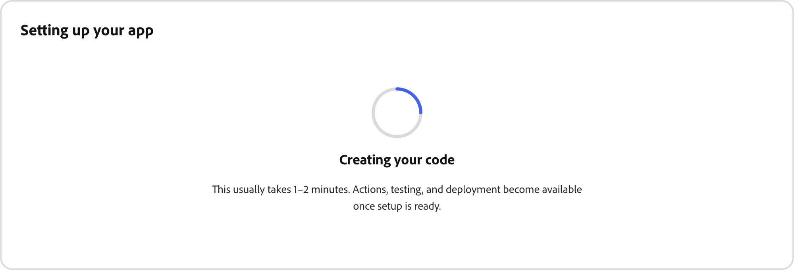
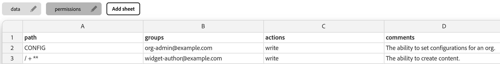

# Configuração da infraestrutura {#create-first-app}

>[!IMPORTANT]
>
>[!DNL Adobe LLM Apps] está atualmente na Beta.
>
>Os recursos, fluxos de trabalho e interface mostrados aqui não representam necessariamente o estado final do produto. Para participar da Beta, envie um email para llm-apps-beta@adobe.com.

A infraestrutura é a base técnica do seu aplicativo: os repositórios que armazenam seu código e os serviços que executam seus manipuladores de ação e fornecem seus widgets aos usuários.

Conforme explicado na [visão geral](/help/overview/overview.md#key-concepts), um **manipulador de ações** executa uma tarefa, como localizar produtos, enquanto um **widget** apresenta o resultado como uma experiência interativa na conversa.

[!DNL LLM Apps] armazena o código-fonte do manipulador e do widget em dois repositórios [!DNL GitHub] separados:

- **Repositório de ações** — contém os manipuladores do lado do servidor e seus testes.
- **Repositório de widgets** — contém o código e os estilos dos widgets interativos.

Por exemplo, um manipulador de pesquisa de produto recupera produtos correspondentes e seu widget os exibe como cartões de produto. Os repositórios armazenam esse código; o Adobe I/O Runtime executa os manipuladores implantados e o Edge Delivery Services fornece os widgets.

O assistente de configuração prepara esses repositórios e conecta os serviços de que seu aplicativo precisa. Recomendamos começar com a **infraestrutura gerenciada pela Adobe**, a maneira mais rápida de começar. O Adobe cria e hospeda os repositórios para seus manipuladores de ação e widgets. Você não precisa configurar repositórios sozinho.

Como alternativa, forneça dois repositórios [!DNL GitHub] vazios em sua própria conta ou organização. A plataforma os inicializa com os arquivos de projeto necessários; não é necessário preparar o código de ação ou widget antecipadamente.

**Neste guia:** saiba como escolher uma opção de infraestrutura e criar seu aplicativo com o assistente de configuração. Após a instalação, continue em [Criar ações](/help/guides/creating-actions.md).

A criação do aplicativo **não** inicia a geração da ação. Inicie a geração de ação separadamente da página do aplicativo.

## Abrir o assistente criar aplicativo

Abra os [Aplicativos Adobe LLM](https://experience.adobe.com/llm-apps). Na página de boas-vindas, selecione **[!UICONTROL Introdução]**. Se você já tiver um aplicativo aberto, use o seletor de aplicativos e selecione **[!UICONTROL Criar novo aplicativo]**.

O assistente **[!UICONTROL Criar Aplicativo LLM]** começa com **[!UICONTROL Introdução]**. Escolha como configurar o ambiente técnico.

| Opção de infraestrutura | Selecionar no assistente | O que significa |
|---|---|---|
| **Infraestrutura gerenciada pela Adobe** | **[!UICONTROL Deixe-nos lidar com isso]** | A Adobe cria e gerencia os repositórios e serviços conectados para seu aplicativo. O acesso ao código está disponível mediante solicitação. |
| **Seus próprios repositórios** | **[!UICONTROL Eu mesmo vou configurar]** | Você fornece dois repositórios GitHub vazios e concede acesso por meio do assistente. A plataforma inicializa um para manipuladores de ação e outro para widgets. |

Ambas as opções oferecem suporte à geração de ação automática posteriormente. Nenhuma opção requer que você grave ações manualmente.

## Usar a infraestrutura gerenciada da Adobe {#adobe-managed-infrastructure}

Use essa opção para permitir que a Adobe configure e gerencie os repositórios e serviços conectados para seu aplicativo. Não é necessário criar repositórios ou instalar [!DNL GitHub] aplicativos você mesmo.

1. Selecione **[!UICONTROL Let us handle it]**.
2. Selecione **[!UICONTROL Próxima etapa]**.
3. Conclua os [detalhes do aplicativo](#app-details).
4. Selecione **[!UICONTROL Criar aplicativo]**.

A página do aplicativo mostra **[!UICONTROL Configurando seu aplicativo]** enquanto o Adobe prepara os repositórios e conecta o site do widget. A interface do usuário indica que a configuração geralmente leva de 1 a 2 minutos; as ações, os testes e a implantação permanecem indisponíveis até que a configuração esteja pronta.

Se a instalação falhar, leia o erro e selecione **[!UICONTROL Repetir]**. Se a página não puder verificar o progresso, a instalação continuará em segundo plano; selecione **[!UICONTROL Verificar novamente]** para se reconectar.

Quando a instalação for concluída, continue com [Criar ações](/help/guides/creating-actions.md).

## Conectar seus próprios repositórios {#your-own-repositories}

Selecione **[!UICONTROL Eu mesmo vou configurar]** e depois **[!UICONTROL Próxima etapa]**. Esse caminho tem quatro etapas do assistente:

**Introdução → Configuração da infraestrutura de ação → Configuração da infraestrutura do widget → Detalhes do aplicativo.**

Você precisa de acesso aos repositórios selecionados e de permissão para instalar ou configurar os [!DNL GitHub] Aplicativos necessários. Para repositórios de propriedade da organização, um administrador pode precisar aprovar o acesso.

Crie dois repositórios vazios: um para manipuladores de ação e um para widgets. Não inicialize com um README, licença ou `.gitignore`. A plataforma adiciona a estrutura do projeto necessária ao validar cada repositório no assistente.

Se você já tiver projetos de ação e EDS compatíveis, poderá conectá-los, mas o código existente não será necessário.

>[!NOTE]
>
>Para um repositório vazio, a validação grava os arquivos iniciais do projeto. Escolha os repositórios destinados a este aplicativo antes de selecionar **[!UICONTROL Validar repositório]**.

### Configurar a infraestrutura de ação

O repositório de ações contém os manipuladores do lado do servidor e os testes que são executados quando uma plataforma LLM chama uma ação.

1. Em **[!UICONTROL Origem das ações]**, selecione **[!UICONTROL GitHub]**. As outras fontes de código não estão disponíveis no momento.
2. Resposta **[!UICONTROL Você tem um repositório GitHub já criado?]**:
   - Selecione **[!UICONTROL Sim, usarei um repositório já criado]** para conectar um projeto existente compatível ou um repositório vazio.
   - Selecione **[!UICONTROL I don&#39;t have a repository yet]** e, em seguida, **[!UICONTROL Create repositories on GitHub]** para criar um repositório de ações vazio. Retorne ao assistente posteriormente.
3. Conecte o repositório ao Aplicativo [!DNL GitHub] do Adobe LLM Apps:
   - Se nenhuma organização estiver conectada, selecione **[!UICONTROL Instalar no GitHub]**.
   - Se uma organização já estiver conectada, selecione **[!UICONTROL Conectar repositório]** e adicione o repositório a essa instalação.
4. Em [!DNL GitHub], escolha **[!UICONTROL Somente selecionar repositórios]** e conceder acesso somente aos repositórios usados por este aplicativo.
5. Retorne ao assistente. Em **[!UICONTROL Selecionar repositório]**, escolha a **[!UICONTROL Organização]** e o **[!UICONTROL Repositório]**.
6. Selecione **[!UICONTROL Validar repositório]**. A validação inicializa um repositório vazio com o modelo de aplicativos Adobe LLM. Um repositório existente deve conter um projeto de ações compatíveis.
7. Após a validação, selecione **[!UICONTROL Próxima etapa]**.

Se uma organização ou repositório estiver ausente, use **[!UICONTROL Conectar outra organização]** ou **[!UICONTROL Conectar outro repositório]** em seu seletor. Depois de alterar o acesso em [!DNL GitHub], selecione **[!UICONTROL Atualizar organizações e repositórios]**.

### Configurar a infraestrutura do widget

Os widgets são respostas visuais opcionais anexadas a ações, como cartões de produto ou formulários de reserva. O assistente conecta um repositório [!DNL Edge Delivery Services] (EDS) para hospedá-los.

Use a mesma conta do Adobe para [!DNL LLM Apps], acesso ao site do AEM e acesso de gravação do DA.

#### Conectar o repositório de widgets {#connect-widget-repository}

1. Em **[!UICONTROL Origem do widget]**, selecione **[!UICONTROL Selecionar repositório de widget manualmente]**.
2. Em **[!UICONTROL Code source]**, selecione **[!UICONTROL GitHub]**.
3. Escolha se você já tem um repositório. Caso contrário, selecione **[!UICONTROL Criar repositórios no GitHub]**, crie um repositório de widget vazio e retorne ao assistente.
4. Instale ou configure o Aplicativo [!DNL GitHub] do Adobe LLM para este repositório, como você fez para o repositório de ações.
5. Selecione sua **[!UICONTROL Organização]** e **[!UICONTROL Repositório]**. Não selecione o repositório de ações.
6. Selecione **[!UICONTROL Validar repositório]**. A validação inicializa um repositório vazio com o modelo do AEM. Um repositório existente deve ser um projeto de EDS compatível.

#### &#x200B;7. Configurar o acesso ao site do AEM {#aem-site-access}

**Nova instalação:** Selecione **[!UICONTROL Instalar Sincronização de Código AEM]** e conceda a ele acesso ao repositório de widgets. Conclua o assistente de configuração na página de confirmação da instalação para adicionar a si mesmo como administrador do site.

**Site EDS existente:** mantenha sua instalação da Sincronização de Código do AEM e confirme se ela abrange o repositório de widgets selecionado. Peça a um administrador de site existente para abrir o Administrador de Usuários do AEM em `https://tools.aem.live/tools/user-admin/index.html/?org=<org>&site=<site>` e adicionar sua conta do Adobe com a função `admin`. Não é necessário reinstalar a Sincronização de código.

Substitua `<org>` e `<site>` por sua organização da AEM e nomes de site. O administrador do site pode confirmar esses valores.

#### &#x200B;8. Conceder acesso de gravação do DA {#da-write-access}

Para sites novos e existentes, peça a um administrador de organização de DAs para:

1. Abra a configuração do DA em `https://da.live/config#/<org>/`, substituindo `<org>` pela organização do DA que armazena o conteúdo do site.
2. Abra a planilha **permissões**. Se não existir, selecione **[!UICONTROL Adicionar planilha]**, nomeie-a como `permissions` e adicione os cabeçalhos de coluna **caminho**, **grupos** e **ações**. Você também pode adicionar uma coluna **comentários** para descrever cada regra.
3. Adicione uma linha que conceda à sua conta da Adobe acesso de gravação a todo o conteúdo do site: use o caminho de conteúdo do site em **caminho**, o email da sua conta do Adobe em **grupos** e `write` em **ações**. Salve a configuração.

   

   A captura de tela usa contas fictícias. Substitua `widget-author@example.com` pelo email da sua conta da Adobe e use o caminho do conteúdo do seu site em vez do exemplo de `/ + **` em toda a organização. A linha `CONFIG` é para administradores de configuração; você não precisa alterá-la para conceder acesso ao conteúdo.

As funções de site do AEM não concedem acesso de gravação do DA. Você não precisa de acesso de gravação em toda a organização.

Para obter detalhes sobre como configurar permissões do DA, consulte [Permissões e segurança](https://www.aem.live/docs/ew/administering/permissions).

#### &#x200B;9. Validar a configuração do AEM {#validate-aem-setup}

1. Retorne a [!DNL LLM Apps] e selecione **[!UICONTROL Validar configuração do AEM]**.
2. Quando a **[!UICONTROL instalação do AEM verificada]** for exibida, selecione **[!UICONTROL Próxima etapa]**.

Se a validação falhar, siga a mensagem para verificar o [acesso ao site do AEM](#aem-site-access) ou o [acesso de gravação do DA](#da-write-access) e valide novamente.

>[!NOTE]
>
>O assistente marca **[!UICONTROL Usar Cloud Manager Edge Delivery Services]** como **[!UICONTROL Em breve]** e não permite seleção. Use a opção manual de repositório de widgets.

## Inserir detalhes do aplicativo {#app-details}

Ambas as opções de infraestrutura terminam com **[!UICONTROL Detalhes do aplicativo]**.

1. Insira o **[!UICONTROL Nome do Aplicativo LLM]**. Use um nome que identifique a marca ou experiência, como *Frescopa Coffee*.
2. Selecione o **[!UICONTROL programa AEM]** ao qual o aplicativo pertence. Se você tiver acesso a apenas um programa, o assistente selecionará esse programa automaticamente.
3. Em **[!UICONTROL Região de dados do Analytics]**, escolha **[!UICONTROL Estados Unidos (EUA)]** ou **[!UICONTROL Europa (UE)]**.
4. Selecione **[!UICONTROL Criar aplicativo]**.

>[!IMPORTANT]
>
>O programa AEM e a região de dados de análise não podem ser alterados após a criação do aplicativo. A região de análise determina onde os dados de análise do aplicativo são armazenados.

Se nenhum programa do AEM estiver disponível, peça acesso ao administrador. Se o carregamento dos programas falhar, selecione **[!UICONTROL Repetir o carregamento dos programas]**.

O assistente abre a página do aplicativo após a criação. Com a infraestrutura gerenciada pela Adobe, aguarde a conclusão da configuração da infraestrutura antes de continuar.

## Próximo: criar as ações

Seu aplicativo agora tem sua infraestrutura, mas nenhuma ação gerada ainda. Continue com [Criar ações](/help/guides/creating-actions.md) para analisar um site ou escolher a criação de ação manual.

Para obter a relação entre metadados de ação, manipuladores, widgets e o servidor MCP implantado, consulte [Como um aplicativo é conectado](/help/guides/app-architecture.md).
