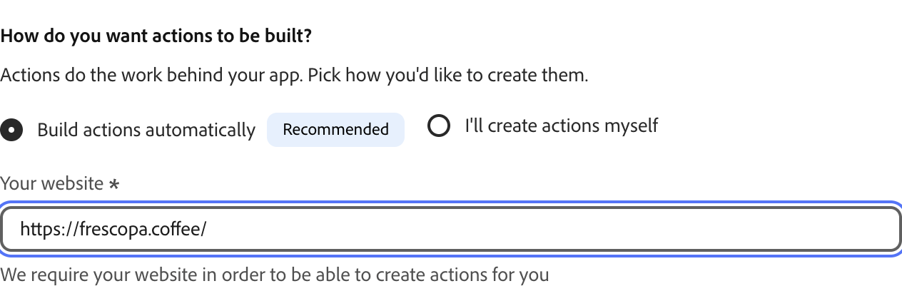
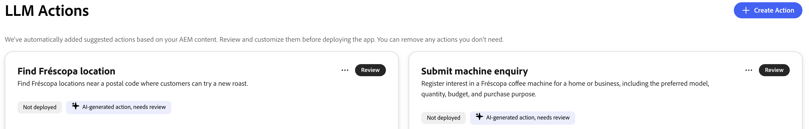
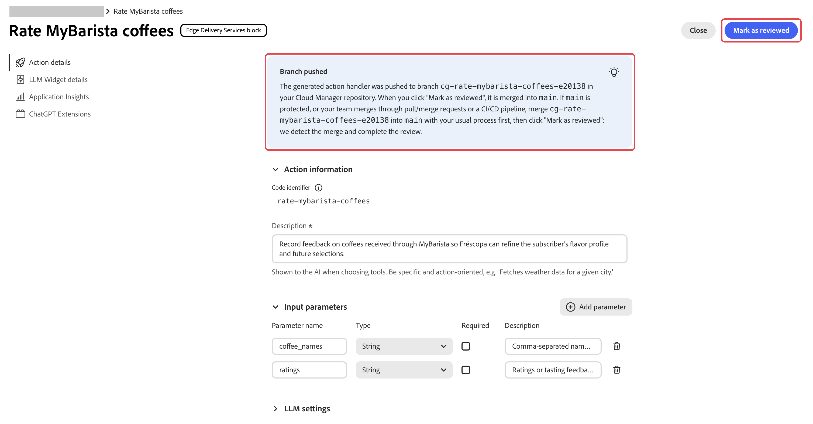

# Criar ações {#creating-actions}

>[!IMPORTANT]
>
>Aplicativos LLM está disponível para todos os clientes do AEM Sites Cloud Service para desenvolver e gerenciar seus próprios aplicativos. Depois que a medição for iniciada, cada chamada de aplicativo será contabilizada nas Solicitações de conteúdo do AEM Sites do cliente. A Adobe anunciará a taxa de medição e a data de início antes de a medição entrar em vigor.

As ações são os recursos que seu aplicativo oferece em uma conversa do LLM, como encontrar produtos, verificar a disponibilidade ou reservar um serviço. Cada manipulador de ação executa a tarefa e um widget opcional apresenta o resultado.

Após a [configuração de infraestrutura](/help/guides/create-app.md), escolha como criar ações na página do aplicativo. A geração automática está disponível com a infraestrutura gerenciada do [!DNL LLM Apps] e seus próprios repositórios.

**Neste guia:** Aprenda a gerar ações do seu site ou criá-las você mesmo. Para geração automática, inicie o processo e revise os resultados antes de implantar e testar o aplicativo.

## Escolher como criar ações

Abra o aplicativo. Se o Adobe ainda estiver preparando sua infraestrutura, aguarde a conclusão da instalação.

Na seção **[!UICONTROL Ações]**, **[!UICONTROL Como você deseja que as ações sejam compiladas?]** O oferece duas opções:

| Opção | Use-o quando |
|---|---|
| **[!UICONTROL Criar ações automaticamente]** | Você deseja que a plataforma analise seu site e gere ações sugeridas, código de manipulador, testes e widgets. Esse é o ponto de partida recomendado. |
| **[!UICONTROL Eu mesmo vou criar ações]** | Você deseja definir cada ação e fornecer sua implementação sozinho. |

Escolher a infraestrutura no assistente criar aplicativo não seleciona nenhuma dessas opções para você.

## Gerar ações de um site {#generate-from-website}

1. Selecione **[!UICONTROL Criar ações automaticamente]**.
2. Em **[!UICONTROL Seu site]**, insira um site HTTPS público que represente os produtos, os serviços ou as tarefas do cliente da sua marca. Este exemplo usa `https://frescopa.coffee/`.
3. Selecione **[!UICONTROL Criar minhas ações]**.

Use um site que você está autorizado a analisar. Não forneça um site que exponha informações confidenciais ou de acesso controlado.

Selecionar **[!UICONTROL Criar minhas ações]** inicia a geração; inserir apenas a URL não inicia. Não é necessário recriar o aplicativo nem reabrir o assistente de infraestrutura.

### Seguir o progresso da geração

A página do aplicativo mostra **[!UICONTROL Ações sendo geradas]**. Selecione **[!UICONTROL Ir para ações]** ou abra **[!UICONTROL Ações]** da navegação para seguir o progresso.

A interface do usuário estima até 30 minutos para geração. Saia da página e retorne posteriormente, se necessário.

Durante a geração, a plataforma:

1. Analisa o site e identifica as tarefas do cliente para o aplicativo.
2. Cria metadados de ação sugeridos, incluindo descrições e parâmetros de entrada.
3. Gera manipuladores do lado do servidor e testes no repositório de ações.
4. Gera widgets no repositório EDS.
5. Prepara as ações geradas para revisão.

Enquanto a plataforma analisa o site, a página Ações mostra **[!UICONTROL Descobrindo ações para sua experiência de conversação]**. As ações sugeridas aparecem à medida que a plataforma as descobre; suas visualizações de código e widget ainda podem estar sendo geradas. Aguarde a conclusão da geração antes de revisar cada ação.

>[!IMPORTANT]
>
>Os manipuladores gerados usam inicialmente dados de amostra representativos. A análise do site não conecta automaticamente seu aplicativo a APIs de produção, inventário em tempo real, serviços de pagamento ou sistemas de reserva.

Se a geração relatar uma falha, leia o erro visível e verifique as [orientações para solução de problemas](/help/reference/troubleshooting.md). Não aprove uma ação simplesmente para ignorar um erro de geração.

## Revisar as ações geradas {#review-generated-actions}

Analise cada ação sugerida antes da implantação. Confirme se ela representa uma tarefa útil e se o comportamento gerado corresponde ao que você pretende que o aplicativo faça.

1. Na página **[!UICONTROL Ações]**, selecione **[!UICONTROL Revisar]** para uma ação pronta.
2. Revise a descrição da ação, os parâmetros de entrada, as anotações, a visibilidade e o manipulador gerado.
3. Reveja a configuração e visualização do widget, se a ação tiver um widget.
4. Inspecione o código gerado e os testes. Com a infraestrutura gerenciada do [!DNL LLM Apps], a plataforma abre solicitações de pull; com seus próprios repositórios, ela envia uma ramificação para cada repositório. Verifique o que é comportamento de amostra e o que deve ser substituído por integrações reais.
5. Quando a ação estiver pronta, selecione **[!UICONTROL Marcar como revisado]**.
6. Retorne à lista de ações e repita as ações restantes.

O editor de ação salva separa **[!UICONTROL Detalhes da ação]**, **[!UICONTROL Detalhes do widget LLM]**, **[!UICONTROL Insights do aplicativo]** e **[!UICONTROL Extensões ChatGPT]**. Revise as alterações geradas no widget e no manipulador em suas respectivas guias.

Selecionar **[!UICONTROL Marcar como revisado]** mescla as alterações geradas se nenhum bloqueador de mesclagem permanecer: puxa solicitações com a infraestrutura gerenciada [!DNL LLM Apps], ramifica com seus próprios repositórios. Se uma solicitação de pull aberta bloquear a revisão, resolva o bloqueador e tente novamente. Não aprove uma implementação com falhas de geração de código não resolvidas ou mesclagem.

Com seus próprios repositórios, sua equipe também pode mesclar a ramificação com seu próprio processo, como uma solicitação de pull ou merge, antes de selecionar **[!UICONTROL Marcar como revisado]**. Se a plataforma não puder mesclar a própria ramificação, por exemplo, porque a ramificação de destino está protegida ou a ramificação tem conflitos, a revisão mostra qual ramificação mesclar em qual base. Mescle e selecione **[!UICONTROL Marcar como revisado]** novamente.

Depois de examinar todas as ações geradas, a página Ações mostra **[!UICONTROL Todas as ações foram revisadas!]**. Para retornar ao aplicativo, selecione **[!UICONTROL Ir para a página do aplicativo]**.

A revisão não é implantação. As ações não estarão disponíveis por meio do servidor MCP do aplicativo até que você o implante.

## Criar ações por conta própria {#manual-actions}

Se preferir não gerar ações de um site:

1. Na opção de criação de ação da página do aplicativo, selecione **[!UICONTROL Eu mesmo criarei ações]**.
2. Selecione **[!UICONTROL Criarei minhas ações]**.
3. Na página Ações, selecione **[!UICONTROL Criar Ação]**.
4. Siga [Criar uma ação do zero](/help/guides/create-action.md) para definir os metadados, implementar um manipulador e conectar um widget, se necessário.

A infraestrutura permanece a mesma. Escolher a criação manual não cria código de manipulador nem conecta os sistemas da empresa para você.

Adicione ações manuais depois de revisar as ações geradas automaticamente, conforme necessário.

## Implantar e testar

Depois de revisar o trabalho gerado:

1. [Implantar o aplicativo](/help/guides/deploy-your-app.md) em **[!UICONTROL Estágio]**.
2. Teste no [ChatGPT](/help/guides/test-in-chatgpt.md) ou [Claude](/help/guides/test-in-claude.md) usando a URL do servidor MCP de preparo.
3. Prompts de teste que correspondem a cada ação e prompts não relacionados que não chamam essa ação. Verifique a resposta do texto e as interações do widget.

Antes de disponibilizar o aplicativo para os clientes, [personalize os manipuladores](/help/guides/customize-handler.md) para conectar suas APIs e [personalizar os widgets](/help/guides/widgets.md). Teste o aplicativo em preparo para confirmar se ele funciona conforme o esperado. Implantar para produção somente após o teste ser bem-sucedido.
