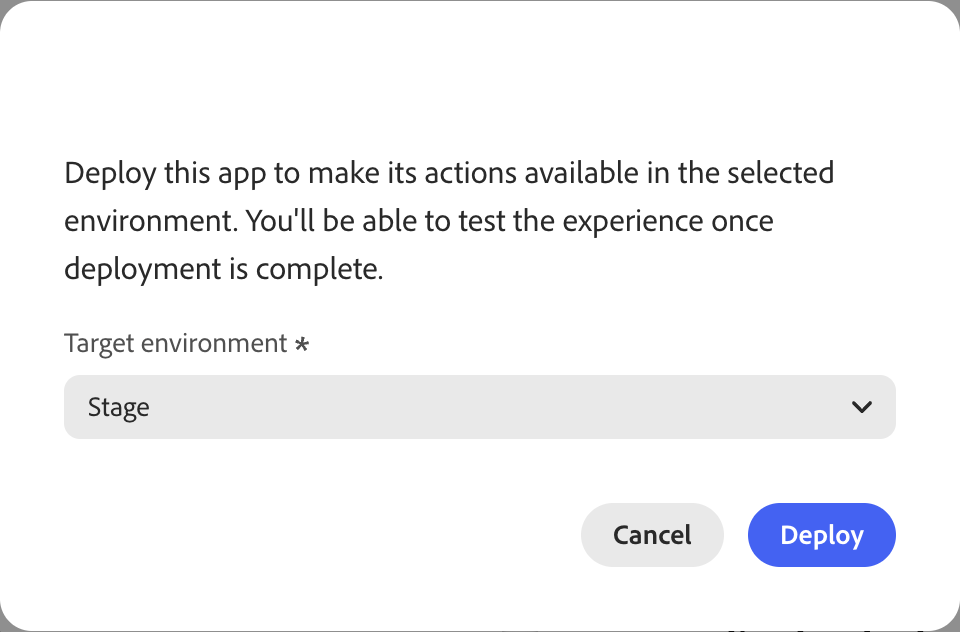
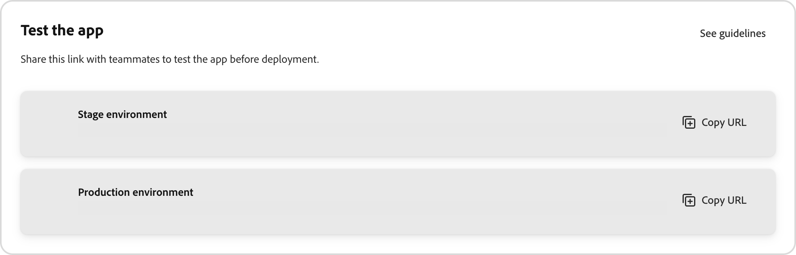
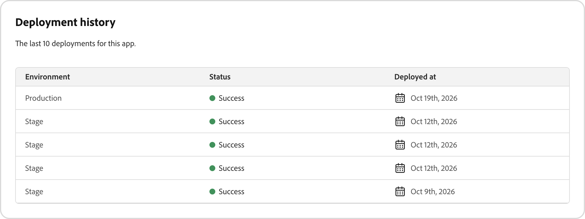

# Implante seu aplicativo {#deploy-your-app}

>[!IMPORTANT]
>
>Aplicativos LLM está disponível para todos os clientes do AEM Sites Cloud Service para desenvolver e gerenciar seus próprios aplicativos. Depois que a medição for iniciada, cada chamada de aplicativo será contabilizada nas Solicitações de conteúdo do AEM Sites do cliente. A Adobe anunciará a taxa de medição e a data de início antes de a medição entrar em vigor.

Depois de analisar as ações geradas ou enviar seu próprio código de manipulador para o repositório vinculado, implante o aplicativo do [!DNL LLM Apps]. Para ações geradas, revise e mescle o trabalho gerado antes da implantação.

**Neste guia:** saiba como implantar seu aplicativo no Stage, verificar o resultado da implantação e copiar a URL do servidor MCP para teste. Implantar para produção após o teste ser bem-sucedido.

## Iniciar a implantação

Abra a página Detalhes do aplicativo e selecione **[!UICONTROL Implantar]**.

Selecione o ambiente de destino e selecione **[!UICONTROL Implantar]**.

Se os seus manipuladores usarem [variáveis de aplicativo](/help/guides/app-variables.md), configure-as para o ambiente de destino antes de implantar. As variáveis adicionadas, atualizadas ou excluídas entram em vigor nessa implantação; Preparo e Produção têm valores independentes.

A implantação é executada em quatro etapas:

1. **Preparando** — recupera a configuração necessária para implantar o aplicativo.
2. **Iniciar implantação** — inicia o processo de implantação em segundo plano.
3. **Criar aplicativo** — instala dependências e cria o código de repositório mais recente.
4. **Publicar** — publica o aplicativo em [!DNL Adobe I/O Runtime].

>[!NOTE]
>
>Se uma ação tiver metadados na interface, mas nenhum arquivo de manipulador correspondente no repositório, a implantação ainda registrará a ação. As chamadas usam um manipulador de stub padrão até que você adicione o código real.

## Depois de uma implantação bem-sucedida

Quando todas as etapas forem concluídas, a caixa de diálogo exibirá **Implantação bem-sucedida**.

Para fechar a caixa de diálogo, selecione **Fechar**. Na página Detalhes do aplicativo, navegue até **[!UICONTROL Testar o aplicativo]**:

Cada ambiente implantado mostra um URL de servidor MCP. Selecione **[!UICONTROL Copiar URL]** e use-a para criar um plug-in ou conector na plataforma LLM de destino.

A seção **Histórico de implantação** mostra as últimas 10 implantações:

Cada linha mostra o **Ambiente** de destino (Preparo ou Produção), **Status** (Bem-sucedido ou Com Falha) e **Implantado na data**. Use a tabela para rastrear datas de implantação e verificar se a implantação mais recente foi bem-sucedida.

## Implantar alterações de configuração

As alterações nos metadados de ação, nos switches de **[!UICONTROL Visibilidade]** da página do aplicativo, na autenticação, nas variáveis do aplicativo e nas configurações do Analytics têm efeito na próxima implantação nesse ambiente. Salvar uma configuração não atualiza o servidor MCP implantado sozinho.

Verifique o ambiente de destino todas as vezes. A implantação em preparo não implanta as mesmas alterações na produção.

Se o aplicativo não atender aos requisitos de tempo de execução de análise ou do SDK, siga [Atualizar um aplicativo existente](/help/guides/upgrade-existing-app.md) antes de reimplantar.

## Próxima etapa

- [Testar o aplicativo implantado como um plug-in ChatGPT](/help/guides/test-in-chatgpt.md).
- [Teste o aplicativo implantado como um conector Claude](/help/guides/test-in-claude.md).
- [Envie os eventos do seu aplicativo para a Adobe Analytics ou a Customer Journey Analytics](/help/guides/analytics-setup.md).
