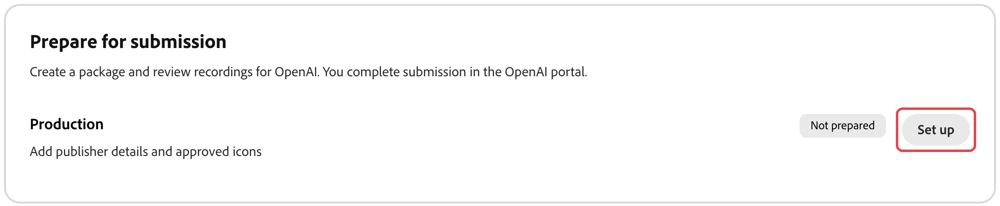
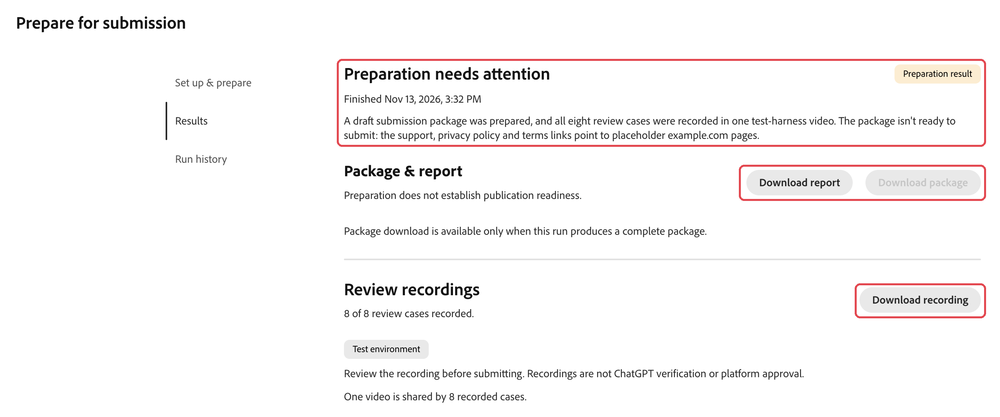

# Preparar seu aplicativo para envio por ChatGPT {#prepare-submission}

>[!IMPORTANT]
>
>Aplicativos LLM está disponível para todos os clientes do AEM Sites Cloud Service para desenvolver e gerenciar seus próprios aplicativos. Depois que a medição for iniciada, cada chamada de aplicativo será contabilizada nas Solicitações de conteúdo do AEM Sites do cliente. A Adobe anunciará a taxa de medição e a data de início antes de a medição entrar em vigor.

Para listar seu aplicativo no diretório de plug-in do [!DNL ChatGPT], carregue um pacote de envio no OpenAI. O [!DNL LLM Apps] ajuda você a prepará-lo. Ele cria o pacote ZIP do aplicativo, envia solicitações de teste para o aplicativo implantado e registra os resultados para que você possa verificá-los. Em seguida, você faz upload do pacote e conclui o envio no portal OpenAI.

**Neste guia:** Saiba como preparar um pacote de envio para seu aplicativo no [!DNL LLM Apps] e o que fazer a seguir no portal OpenAI.

>[!NOTE]
>
>[!DNL LLM Apps] não envia seu aplicativo para OpenAI. Verificação de desenvolvedor e domínio, teste de conexão, revisão e publicação ocorrem no portal OpenAI. Consulte [Carregar e enviar seu plug-in](https://developers.openai.com/plugins/deploy/submission).

## Antes de começar

- [Implante seu aplicativo](/help/guides/deploy-your-app.md) para **Produção**. [!DNL LLM Apps] envia suas solicitações de teste para a versão de Produção do seu aplicativo.
- Verifique se as ações que deseja publicar foram revisadas e ativadas.
- Prepare o nome do editor e os URLs da página de suporte, a política de privacidade e os termos de serviço.
- Tenha dois ícones prontos: um logotipo e um ícone de compositor. Cada deve ser um quadrado, PNG não animado, 64-4096 pixels por lado, e não maior do que 1 MiB. Use somente imagens que você tenha permissão para publicar.
- Se o aplicativo [autentica usuários finais](/help/guides/authentication.md), registre um cliente OAuth para [!DNL ChatGPT] no provedor de identidade, a menos que o provedor de identidade ofereça suporte ao registro dinâmico de cliente (DCR) ou aos documentos de metadados de ID de cliente (CIMD).

## Abrir Preparação para envio

Depois de implantar seu aplicativo para produção pela primeira vez, a página do aplicativo mostra o cartão **[!UICONTROL Preparar para envio]** abaixo de **[!UICONTROL Testar o aplicativo]**.

Selecione **[!UICONTROL Configurar]**. Posteriormente, o botão no cartão é alterado para mostrar a próxima etapa, como **[!UICONTROL Exibir progresso]** ou **[!UICONTROL Exibir resultados]**.

A caixa de diálogo **[!UICONTROL Preparar para envio]** é aberta. Ele tem três seções: **[!UICONTROL Configurar e preparar]**, **[!UICONTROL Resultados]** e **[!UICONTROL Histórico de execução]**.

## Adicione os detalhes do envio

Em **[!UICONTROL Configurar e preparar]**:

1. Em **[!UICONTROL Fornecedor e assuntos legais]**, digite **[!UICONTROL Nome do editor]**, **[!UICONTROL URL de suporte]**, **[!UICONTROL URL da política de privacidade]** e **[!UICONTROL URL dos Termos de serviço]**.
   - Para **[!UICONTROL Nome do editor]**, insira o nome público que você verificará como editor no portal OpenAI.
   - Para a **[!UICONTROL URL de suporte]**, insira a URL de uma página de suporte ou de contato. Um endereço de email não é aceito.
   - A política de privacidade deve descrever os dados que seu aplicativo, autenticação, widget e análise coletam e usam.
2. Em **[!UICONTROL Ícones aprovados]**, selecione **[!UICONTROL Escolher logotipo]** e **[!UICONTROL Escolher ícone de compositor]** e escolha um arquivo PNG para cada um.
3. Se o aplicativo usa autenticação, abra o **[!UICONTROL registro de cliente OAuth]** e escolha como [!DNL ChatGPT] obterá um cliente OAuth. Escolha somente uma opção que seu provedor de identidade suporta:
   - **[!UICONTROL Fornecido]** - você registrou um cliente para [!DNL ChatGPT]. Insira sua **[!UICONTROL ID de cliente registrada]**. Não insira a ID de cliente do Adobe IMS.
   - **[!UICONTROL DCR]** - [!DNL ChatGPT] registra um cliente usando o registro de cliente dinâmico.
   - **[!UICONTROL CIMD]** - [!DNL ChatGPT] identifica-se com um documento de metadados de ID de cliente.

   [!DNL LLM Apps] nunca pede um segredo de cliente.
4. Opcionalmente, abra **[!UICONTROL Detalhes adicionais do envio]** e insira o texto da lista, o nome e a versão do pacote, os detalhes da compra, a URL de demonstração hospedada, os países com suporte e as notas de versão. Se você deixar um campo em branco, o [!DNL LLM Apps] rascunhará o texto onde for possível. Tudo o que não puder ser rascunho aparecerá posteriormente em **[!UICONTROL Antes de enviar]**.
5. Selecione **[!UICONTROL Salvar alterações]**.

A preparação usa apenas os detalhes e os ícones que você salvou.

>[!TIP]
>
>Os revisores do OpenAI precisam de um vídeo de demonstração do seu aplicativo, idealmente gravado em [!DNL ChatGPT], em uma URL que possam abrir. A gravação de teste de [!DNL LLM Apps] é para suas próprias verificações e não substitui esta demonstração. Grave a demonstração, carregue-a em um local que os revisores possam acessar e insira a URL na **[!UICONTROL URL de demonstração hospedada]** antes de preparar o pacote.

## Preparar o pacote

Em **[!UICONTROL Preparar seu pacote]**, verifique a **[!UICONTROL Disponibilidade]**. **[!UICONTROL Pronto para preparar]** significa que os detalhes salvos atendem aos requisitos. Caso contrário, a seção lista o que está faltando, como um detalhe necessário ou uma implantação de Produção bem-sucedida.

1. Leia **[!UICONTROL O que acontece quando você se prepara]**. [!DNL LLM Apps] cria o pacote e envia solicitações de teste para o aplicativo implantado. Isso pode levar vários minutos e as solicitações de teste podem aparecer nas análises do aplicativo.
2. Selecione a **[!UICONTROL Compreendo que isso chamará meu aplicativo implantado para preparar evidências da revisão.]** caixa de seleção
3. Selecione **[!UICONTROL Preparar pacote]**.

Durante a execução da preparação, a caixa de diálogo mostra **[!UICONTROL Preparação em andamento]**. O [!DNL LLM Apps] usa o aplicativo e os detalhes como estavam quando você selecionou **[!UICONTROL Preparar pacote]**.

Você pode fechar a caixa de diálogo e voltar mais tarde. A preparação continua em segundo plano, e o cartão na página do aplicativo mostra **[!UICONTROL Preparando o pacote]** até que ele seja concluído. Se a preparação falhar, os detalhes salvos serão mantidos.

## Revise os resultados

Ao concluir a preparação, abra **[!UICONTROL Resultados]**. A parte superior da seção resume o resultado. **[!UICONTROL A preparação requer atenção]** significa que [!DNL LLM Apps] criou um pacote de rascunho, mas encontrou problemas que você deve corrigir primeiro, como links legais de espaço reservado.

- **[!UICONTROL Pacote e relatório]** - selecione **[!UICONTROL Baixar pacote]** para obter o ZIP de envio e **[!UICONTROL Baixar relatório]** para obter o relatório de preparação. **[!UICONTROL O pacote de download]** está disponível somente quando a preparação produz um pacote completo.
- **[!UICONTROL Revise as gravações]** - selecione **[!UICONTROL Baixar gravações]** e assista ao vídeo para confirmar se o aplicativo se comporta conforme o esperado. Um vídeo pode incluir vários casos de teste.
- **[!UICONTROL Casos de teste]** - para cada caso de teste, verifique a solicitação que foi enviada e seu status. Abra **[!UICONTROL Comportamento esperado]** para ver o que o aplicativo deve fazer. Alguns casos de teste pedem coisas que seu aplicativo não suporta. Para isso, o aplicativo deve recusar a solicitação sem chamar uma ação.

As gravações vêm do ambiente de teste [!DNL LLM Apps]. Eles não significam que [!DNL ChatGPT] verificou seu aplicativo ou que o OpenAI o aprovou.

**[!UICONTROL Antes de enviar]** lista os detalhes que você ainda precisa confirmar ou inserir, como a versão do pacote, se o aplicativo envolve compras, a URL de demonstração hospedada, os países com suporte e as notas de versão. Abaixo da lista, cada verificação mostra **APROVADA**, **AVISO** ou **FALHA**. Expanda uma marca de seleção para ver os detalhes. Para corrigir um detalhe, selecione **[!UICONTROL Atualizar detalhes]**, salve as alterações e prepare o pacote novamente.

Se você alterar seu aplicativo ou seus detalhes após a preparação, **[!UICONTROL Resultados]** mostrará **[!UICONTROL Aplicativo ou entradas alteradas desde esta execução]**. Selecione **[!UICONTROL Preparar novamente]** para criar um novo pacote do aplicativo e dos detalhes atuais. **[!UICONTROL Executar histórico]** lista as preparações anteriores. Abrir um não altera os detalhes salvos.

## Enviar no portal OpenAI

Quando o pacote estiver concluído, baixe-o e siga [Fazer upload e enviar seu plug-in](https://developers.openai.com/plugins/deploy/submission) na documentação do OpenAI para:

1. Faça upload do ZIP e corrija todos os problemas encontrados pelas verificações automáticas.
2. Conecte seu servidor MCP e conclua a verificação de domínio.
3. Insira as informações de revisão, incluindo detalhes de logon de revisores se o aplicativo exigir logon, e envie o aplicativo para revisão.
4. Publicar o plug-in aprovado.

Para verificar seu domínio:

1. Depois de fazer upload do pacote, copie o token de desafio que o portal OpenAI mostra.
2. No [!DNL LLM Apps], abra as **[!UICONTROL Configurações]** > **[!UICONTROL Envio]** do seu aplicativo.
3. Em **[!UICONTROL Verificação de domínio]**, cole o token no **[!UICONTROL token de desafio do OpenAI]** e selecione **[!UICONTROL Salvar]**.
4. [Implante seu aplicativo](/help/guides/deploy-your-app.md) para produção novamente. O token é publicado somente após a próxima implantação.
5. Retorne ao portal OpenAI e conclua a verificação.

O [!DNL LLM Apps] fornece o token em `/.well-known/openai-apps-challenge` no domínio do seu aplicativo, portanto, você mesmo não precisa hospedá-lo.

### Dicas para uma revisão suave

- **Verifique a autenticação de cada ação.** Quando o portal OpenAI verifica o servidor MCP, ele chama cada ação. Se uma ação for marcada como exigindo autenticação, mas a chamada não puder ser autenticada, a verificação falhará. Em seguida, é necessário corrigir o aplicativo, preparar um novo pacote e carregá-lo novamente.
- **Permitir tempo para a revisão.** Depois de enviar, o OpenAI revisa seu aplicativo antes que você possa publicá-lo e envia feedback por email. Leve esse tempo em consideração ao planejar a data de lançamento.
- **Carregar um novo pacote ao listar alteração de detalhes.** Após a publicação, o [!DNL ChatGPT] seleciona as alterações no servidor MCP automaticamente quando você reimplanta. As alterações nos detalhes da lista ou em outros metadados de pacote precisam de um novo pacote. Prepare-o novamente em [!DNL LLM Apps] e carregue-o no portal OpenAI.

## Relacionados

- [Implante seu aplicativo](/help/guides/deploy-your-app.md)
- [Testar seu aplicativo LLM como um plug-in ChatGPT](/help/guides/test-in-chatgpt.md)
- [Configurar extensões do ChatGPT](/help/guides/chatgpt-extensions.md)
