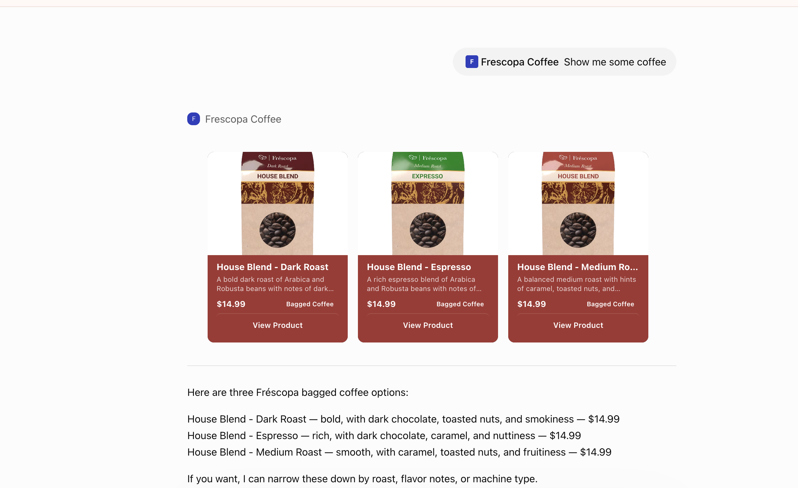

# Testar seu aplicativo LLM como um plug-in [!DNL ChatGPT] {#test-in-chatgpt}

>[!IMPORTANT]
>
>Aplicativos LLM está disponível para todos os clientes do AEM Sites Cloud Service para desenvolver e gerenciar seus próprios aplicativos. Depois que a medição for iniciada, cada chamada de aplicativo será contabilizada nas Solicitações de conteúdo do AEM Sites do cliente. A Adobe anunciará a taxa de medição e a data de início antes de a medição entrar em vigor.

Após a implantação, o aplicativo LLM expõe um URL de servidor MCP. Adicione esta URL a [!DNL ChatGPT] como um plug-in e teste as ações e widgets gerados.

**Neste guia:** Saiba como conectar seu aplicativo implantado ao [!DNL ChatGPT] e testar suas ações e widgets em uma conversa. Atualize a conexão após alterar o aplicativo.

## Requisitos do plano

Use uma conta e um espaço de trabalho que permitam adicionar servidores MCP personalizados. A disponibilidade e os controles do administrador variam de acordo com a conta e o espaço de trabalho. Consulte a documentação atual do [Connect e teste seu plug-in](https://developers.openai.com/plugins/deploy/connect-chatgpt) do OpenAI.

## Verificar o acesso a servidores MCP personalizados

Abra os [ChatGPT Plugins](https://chatgpt.com/plugins) e verifique se sua conta permite adicionar um servidor MCP personalizado. Se sua conta exigir o modo de desenvolvedor, ative esse modo usando os controles da conta. Se a opção de servidor MCP personalizado estiver ausente ou bloqueada, pergunte ao administrador do espaço de trabalho.

## Copie o URL do servidor MCP

Em [!DNL LLM Apps]:

1. Abra a página Detalhes do aplicativo.
2. Localizar **[!UICONTROL Testar o aplicativo]**.
3. Em **[!UICONTROL Ambiente de preparo]**, selecione **[!UICONTROL Copiar URL]**.

## Criar o plug-in

1. Abra [chatgpt.com/plugins](https://chatgpt.com/plugins).
2. Selecione **+**, depois **[!UICONTROL Adicionar servidor MCP personalizado]**.
3. Configure a conexão:
   - **[!UICONTROL Nome]** — o nome do plug-in.
   - **[!UICONTROL Descrição]** — opcional.
   - Escolha o método de conexão de servidor público e insira o URL completo do servidor HTTPS do seu aplicativo.
   - Escolha o método de autenticação que corresponde ao seu aplicativo. Para um aplicativo público com autenticação desabilitada, use **[!UICONTROL Sem Autenticação]** quando oferecido.

   >[!NOTE]
   >
   >Se você ativou a autenticação do usuário final, selecione **[!UICONTROL OAuth]** quando cada ação estiver definida como **[!UICONTROL Obrigatória]** ou **[!UICONTROL Mista]** para uma combinação de ações públicas e protegidas, em que essas opções são oferecidas. Consulte [Autenticar usuários finais com seu próprio provedor de identidade](/help/guides/authentication.md).

4. Selecione **[!UICONTROL Entendo e desejo continuar]**.
5. Selecione **[!UICONTROL Criar como um plug-in]**.
6. Revise as ferramentas e os metadados descobertos, instale ou conecte o plug-in resultante. Conclua o logon se seu aplicativo exigir.

O OpenAI é proprietário da interface do usuário de configuração e seu layout pode variar de acordo com a conta. Siga as [instruções de conexão](https://developers.openai.com/plugins/deploy/connect-chatgpt) atuais se os rótulos exibidos forem diferentes.

## Testar o plug-in

1. Inicie um novo chat.
2. Digite `@` na caixa de prompt e selecione o plug-in instalado.
3. Faça uma pergunta que corresponda a uma das ações geradas. Por exemplo: *Mostre-me um pouco de café.*

Verifique se:

- [!DNL ChatGPT] invoca a ação esperada.
- O widget exibe os dados de amostra esperados.
- A resposta de texto corresponde ao widget.
- Os controles de widget funcionam conforme esperado.

Teste também entradas inválidas, resultados vazios, prompts não relacionados que não chamam o aplicativo e ações que alteram dados. Revise cada prompt de confirmação e autenticação em vez de aprovar todas as solicitações antecipadamente.

### Testar extensões opcionais

Se você configurou [extensões ChatGPT](/help/guides/chatgpt-extensions.md), tente cada ponto de entrada selecionado, configuração de exibição e pesquisa do compositor e compare o resultado com o comportamento esperado nesse guia. Se vários pontos de entrada usarem o mesmo widget, teste todas as formas selecionadas de abri-lo, inclusive sem um arquivo para Global ou Thread. Conectar o aplicativo ou invocar uma ação em uma conversa não verifica esses recursos. Verifique primeiro os [requisitos do cliente](/help/guides/chatgpt-extensions.md#before-you-begin): os pontos de entrada do arquivo exigem área de trabalho, e o suporte da Web para a extensão do OpenAI exclui o ChatGPT clássico.

## Atualizar após alterações no aplicativo

Depois de alterar as descrições de ação, entradas, autenticação ou configuração de widget:

1. Implante o aplicativo atualizado no mesmo ambiente.
2. Abra sua conexão em [ChatGPT Plugins](https://chatgpt.com/plugins) e selecione **[!UICONTROL Atualizar]**.
3. Verifique se as ações anunciadas foram alteradas.
4. Inicie uma nova conversa e repita os testes afetados.

## O que vem a seguir

- [Personalizar os widgets gerados](/help/guides/widgets.md).
- [Criar uma ação do zero](/help/guides/create-action.md).
